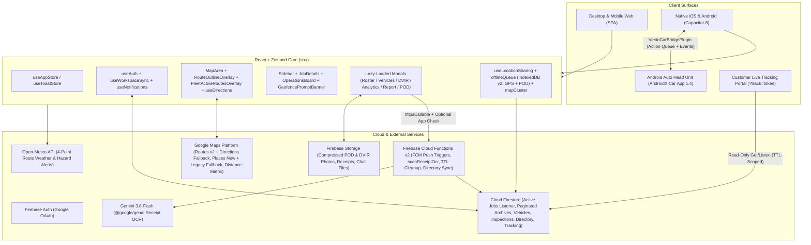

# VECTO Route Tracker — Deep-Dive Architecture Audit, Capability Review & Improvement Roadmap

**Reviewed Repository:** `d:\_ Data\VECTO - route-tracker`  
**Audit Updated:** 2026-11-18  
**Tech Stack:** React 19, Vite 8, Zustand 5, Tailwind CSS v4, Firebase v12 (Auth, Firestore with `persistentLocalCache`, Storage, Messaging, Cloud Functions v2, optional App Check), `@vis.gl/react-google-maps`, `@google/genai` (Gemini 3.8 Flash), Capacitor 8 (Android, iOS, Background Geolocation), AndroidX Car App Library 1.4 (Android Auto)

---

## 1. Executive Summary & System Architecture

**VECTO** is a cross-platform real-time route tracking, dispatch, and fleet-operations application supporting desktop/mobile web browsers, native iOS/Android Capacitor apps, an Android Auto head-unit companion interface, and token-scoped customer live delivery tracking portals (`?track=<token>`).



### Overall Assessment
VECTO delivers substantial operational coverage across dispatch and field workflows: role-aware Dispatcher vs. Driver experiences, four custom route visualization modes, zoom-aware driver clustering, directional heading/speed telemetry with vehicle unit badges, multi-stop TSP optimization with per-stop arrival/completion/SLA windows/dwell durations/offline-resilient compressed POD capture, Google Routes API v2 & Places Autocomplete (New) adapters with automatic legacy fallbacks, a 4-stage drag-and-drop Kanban Operations Board, active-only live job subscriptions with cursor-paginated archives, proximity & Distance Matrix live-traffic smart dispatch + Driver Roster rotation, a Fleet Vehicle Registry with preventive maintenance alerts, 10-point Pre-/Post-Trip DVIR safety inspections & mechanic sign-off, server-proxied Gemini receipt OCR & expense ledger workflows, Fleet KPI & Cost-per-Mile analytics with CSV export, QR/URL onboarding, offline GPS/POD queuing & breadcrumb playback, Open-Meteo route hazard detection, read-only customer tracking links, Cloud Functions v2 push/cleanup automation, an Android Auto bridge with multi-stop advancement, React.lazy bundle code-splitting, and an automated Vitest + Firestore Rules test suite.

All planned implementation phases (**Baseline Phases 1–5** and **Phases A–E**) are now complete in the local codebase and ready for deployment and live end-to-end testing.

---

## 2. Detailed Capability Review & Findings

### 2.1 Map Engine & Custom Route Visualization
* **Files:** `src/components/layout/MapArea.jsx`, `src/components/layout/RouteOutlineOverlay.jsx`, `src/components/modals/MapSettingsModal.jsx`, `src/utils/mapCluster.js`
* **Current Capabilities:**
  * Dark-mode Google Vector Map (`mapId="vecto-main-map"`, `colorScheme="DARK"`) with `AdvancedMarker`, colored `Pin` markers, rotated heading arrow badges (`HeadingArrowBadge`), live MPH speed & matched vehicle `[unitNumber]` badges in `DriverMarkers` nameplates/info windows, and toggleable fleet `showNameplates`.
  * Four route overlay modes (`alternating`, `outlined`, `traffic`, `solid`) using zero-react-render Google `Polyline` layers and an imperative HiDPI `<canvas>` `OverlayView` (`destination-out` hollow-center mask).
  * Latitude-scaled `cos(lat)` `splitPathAtLocation()` projecting driver coordinates onto the polyline to separate travelled vs. upcoming segments.
  * Zoom-aware grid clustering (`clusterDriverMarkers` below zoom 14), floating `"My Location"`, `"Fit Fleet"`, and `"Fit Route"` controls, and an optional dispatcher `"All Active Fleet Routes"` multi-route overlay (`FleetActiveRoutesOverlay`).
  * Visibility-gated dash animation (`document.visibilityState` + active map view check) preventing off-screen `120ms` timer drain.
* **Remaining Gaps:**
  * Dispatcher multi-route overlay draws straight stop-to-stop geometry from geocoded coordinates rather than full road-snapped polylines unless each job has been individually routed.

### 2.2 Routing, Multi-Stop Execution & Geofencing
* **Files:** `src/hooks/useDirections.js`, `src/utils/googleRoutesAdapter.js`, `src/components/common/PlacesAutocompleteInput.jsx`, `src/components/modals/CreateJobModal.jsx`, `src/utils/stops.js`, `src/hooks/useGeofenceArrival.js`, `src/components/jobs/GeofencePromptBanner.jsx`
* **Current Capabilities:**
  * Modern `PlacesAutocompleteInput` (`placesLib.AutocompleteSuggestion.fetchAutocompleteSuggestions` with session tokens & keyboard navigation) plus automatic fallback to legacy `places.Autocomplete` if disabled or unavailable; `MAX_STOPS = 25` guardrail matching Google route limits, automatic geocoding on save (`geocodeMissingStops`) for manually typed stops, and TSP `optimizeWaypoints` write-back.
  * `computeFleetRoute` (`src/utils/googleRoutesAdapter.js`) prefers `routesLibrary.Route.computeRoutes` (`TRAFFIC_AWARE` + custom A/B/C stop markers) and seamlessly falls back for the session to `DirectionsService` / `DirectionsRenderer` (`preserveViewport: true` + initial `fitBounds`) if Routes API is blocked on the API key.
  * Per-stop SLA delivery windows (`arriveBy`) and estimated service/dwell durations (`serviceMinutes`) evaluated by `evaluateStopSla` / `evaluateJobSlaSummary` in `src/utils/stops.js`, plus remaining route `totalDwellMinutes` calculated in `useDirections.js` and surfaced in `JobDetails.jsx` and `OperationsBoard.jsx`.
  * 150m geofence arrival banner (`useGeofenceArrival` + `GeofencePromptBanner`) and 3-strike off-route detour recalculation (~175m tolerance) skipping completed stops.
* **Remaining Notes:**
  * Per-stop contact phone/notes remain global per job rather than individually scoped per stop.

### 2.3 Real-Time Telemetry, Breadcrumbs & Offline Resilience
* **Files:** `src/hooks/useLocationSharing.js`, `src/utils/offlineQueue.js`, `src/utils/geohash.js`, `src/firebase.js`
* **Current Capabilities:**
  * Native background tracking (`@capacitor-community/background-geolocation`, `distanceFilter: 10`) and web `navigator.geolocation.watchPosition` fallback capturing normalized `heading`, `speed` (mph), and `accuracy` (m).
  * Ref-backed job/user state inside `useLocationSharing` ensures job switching updates `activeJobId` without tearing down or leaking native foreground watchers.
  * Browser Firestore writes are throttled (skipping writes under `12s` and `< 8m` movement unless `activeJobId` changes) to cut idle Firestore write costs.
  * Firestore `persistentLocalCache()` + IndexedDB `vecto_offline_db` queue deduplicating latest `active_drivers` state and batch-flushing historical `breadcrumbs` chunks (`<= 150` pts/doc) for Planned-vs-Actual SVG playback in `JobReportModal.jsx`.
* **Remaining Gaps:**
  * Precision-7 geohashes (`src/utils/geohash.js`) are recorded on `active_drivers` docs but not yet leveraged for nearest-driver spatial dispatch queries.

### 2.4 Security Rules, Multi-Tenancy & Privacy
* **Files:** `firestore.rules`, `storage.rules`, `functions/index.js`, `src/firebase.js`, `src/utils/crypto.js`, `src/components/CompanySelector.jsx`, `src/components/modals/CompanySettingsModal.jsx`, `src/components/modals/AdminSettingsModal.jsx`, `src/hooks/useFirebase.js`
* **Implemented Security Controls (Phase A + Phase C):**
  * **Tenant Directory & PII Isolation (Phase C):** Public fleet discovery uses `/company_directory/{companyId}` (`name`, `requirePassword`, `createdBy`) mirrored by `syncCompanyDirectory`, while company contact PII (`address`, `contactName`, `phone`, `email`) lives in member-only `/companies/{companyId}/private/profile` and `removedMemberIds` lives in dispatcher-only `/companies/{companyId}/private/security` (`isRemovedMember`). Newly created `/companies` docs reject `password` and `passwordHash` fields.
  * **Server-Side Gemini OCR & App Check (Phase C):** `scanReceiptOcr` in `functions/index.js` keeps `GEMINI_API_KEY` in Firebase Secret Manager (keeping optional local dev override only as fallback), and `src/firebase.js` initializes ReCaptcha Enterprise App Check when `VITE_RECAPTCHA_SITE_KEY` is configured.
  * **Server-Enforced Company Passwords & Secret Isolation:** Company access password hashes (`hashCompanyPassword` salted by `companyId`) are stored in `/companies/{companyId}/private/security` (readable/writable by dispatchers only) and verified server-side via `/companies/{companyId}/join_requests/{userId}` (`hasValidJoinProof`) during `members/{memberId}` creation.
  * **Least-Privilege Job Mutations (`isAssignedDriverOnJob`):** Non-dispatcher drivers can only mutate jobs they are assigned to (cannot cancel or archive), self-assign onto open/unassigned jobs (`size() + 1` preserving existing drivers), or bump `lastMessageTimestamp` for team chat.
  * **Scoped & Expiring Customer Tracking:** `/public_tracking/{token}` creation/updates require dispatcher or assigned-driver status on the job, and terminal jobs (`completed`, `cancelled`, `archived`) stamp a 72-hour `expiresAt` enforced in `firestore.rules` `allow get` and purged hourly by `cleanupStaleFleetData`.
  * **Immutable Storage Evidence & Cleanup:** `storage.rules` forbids overwriting existing chat/receipt/POD/DVIR uploads (`allow create` with `resource == null`, `allow update: if false`) while permitting dispatchers or the uploading user (`_<uid>_` filename pattern) to delete files.
  * **Fleet Vehicle & DVIR Inspection Rules (Phase D):** `/companies/{companyId}/vehicles/{vehicleId}` (`isValidVehicle`) allows dispatcher CRUD while restricting company members to DVIR telemetry updates (`odometerMiles`, `lastInspectionStatus`, `lastInspectionAt`, `status` limited to unchanged or `'out_of_service'`); `/companies/{companyId}/inspections/{inspectionId}` (`isValidInspection`) enforces `driverId == request.auth.uid` on creation and dispatcher-only mechanic defect resolution updates; `/companies/{companyId}/jobs/{jobId}` validates optional `vehicleId` and `vehicleLabel` linkage; `/dvir/{companyId}/{vehicleId}/{fileName}` secures defect inspection photos in Storage.
* **Remaining Security & Migration Notes:**
  * Legacy `/companies/{companyId}` docs retain `allow read: if isAuthenticated()` while older fleets migrate to `/company_directory/{companyId}`; once all existing companies are migrated via `syncCompanyDirectory` or dispatcher saves, `/companies/{companyId}` reads can be tightened to `isCompanyMember(companyId)`.

### 2.5 Job Lifecycle, Dispatch & Operations Kanban Board
* **Files:** `src/components/operations/OperationsBoard.jsx`, `src/components/jobs/JobDetails.jsx`, `src/components/jobs/JobsList.jsx`, `src/components/layout/Sidebar.jsx`
* **Current Capabilities:**
  * Full status workflow (`unassigned`, `assigned`, `in-progress`, `pending-completion`, `completed`, `cancelled`, `archived`) with `JobDetails` rendering instructions (priority + driver targeting), assigned `vehicleLabel` badge, per-stop SLA (`arriveBy`) & dwell badges, `"Log Vehicle DVIR"` drawer shortcut, clickable `tel:`/`sms:` contacts, live `notes`, unread chat tracking (`lastRead`), and 4-style route switchers (`Fade Road`, `Outline`, `Traffic`, `Solid`).
  * **Scaled Active vs. Paginated Archive Architecture (Phase E):** `useWorkspaceSync` subscribes live only to `where('archived', '==', false)` (with one-time legacy `archived` field backfill), while `useArchivedJobs()` (`ARCHIVE_PAGE_SIZE = 25`) cursor-paginates archived jobs (`archived == true`, ordered by `createdAt desc` indexed in `firestore.indexes.json`, with missing-index fallback) inside `JobsList` (`"Load More Archived Jobs"` / `"Refresh"`) and `FleetAnalyticsModal`, unified via `mergeActiveAndArchivedJobs`.
  * 4-column drag-and-drop **Operations Board** with toolbar `"Vehicles"` and `"Analytics"` launchers, Today vs. All Completed filtering, one-click `"Archive"` batch action, card vehicle & SLA summary badges, inline standby quick-assign (`<select>` + `"Nearest"` proximity button + `"Next"` roster button with primary vehicle auto-attach), `"Approve & Complete"` action on `pending-completion` cards, `startedAt` + `public_tracking` sync, and safe `toMillisSafe()` timestamp handling across all views.
  * Self-service driver **Duty Status** segmented control (`On Duty`, `On Break`, `Off Duty`) and **Pre/Post DVIR** / **Fleet Units** quick buttons in `Sidebar.jsx` and `DriverRosterModal.jsx`.

### 2.6 Driver Roster, Proximity Smart Dispatch & Rotation
* **Files:** `src/components/modals/DriverRosterModal.jsx`, `src/utils/roster.js`, `src/utils/proximityDispatch.js`, `src/components/modals/CreateJobModal.jsx`, `src/components/operations/OperationsBoard.jsx`
* **Current Capabilities:**
  * `sortDriverRoster` sorts by duty status (`on_duty` > `break` > `off_duty`), Priority Driver flag, manual `rosterOrder`, and `lastDispatchedAt`. Both `CreateJobModal` and `OperationsBoard` rotate dispatched drivers to the back of the queue and auto-attach a driver's primary active vehicle when creating/assigning a job.
  * `rankDriversByProximity` (`src/utils/proximityDispatch.js`) ranks candidates by duty availability, active `"Busy"` trip status, Priority flag, and estimated road distance/ETA to the geocoded origin (`geocodeAddressCached`), while `fetchLiveTrafficEtas` queries Google `DistanceMatrixService` for live traffic travel times via the `"Nearest Driver"` and `"Live ETA"` controls.

### 2.7 Proof of Delivery (POD), Customer Tracking & Deep Links
* **Files:** `src/components/modals/PodCaptureModal.jsx`, `src/utils/imageCompression.js`, `src/utils/offlineQueue.js`, `src/components/CustomerTrackingView.jsx`, `src/components/modals/InviteModal.jsx`, `src/utils/publicTracking.js`, `src/utils/formatters.js`
* **Current Capabilities:**
  * Client-side canvas JPEG compression (`compressImageFile`, `maxDimension = 1600`, `quality = 0.78`) in `PodCaptureModal.jsx` and `DvirModal.jsx` cuts mobile camera photo sizes before upload.
  * Per-stop delivery photo + pointer-captured signature pad, automatic progress notes, and GPS coordinate stamping (`capturedLat`, `capturedLng`) rendered in `JobReportModal.jsx`.
  * **Offline POD Queue (Phase E):** When submitted offline or during cellular network failures, `PodCaptureModal` serializes compressed photo/signature assets via `blobToDataUrl`, persists them to IndexedDB `pod_queue` (`saveOfflinePod`), applies an optimistic local-cache stop completion update, and auto-uploads + syncs via `flushOfflinePodQueue` in `useFirebase.js` and `useLocationSharing.js` upon reconnect.
  * Canonical public URL resolver (`getPublicAppBaseUrl` using `VITE_PUBLIC_APP_URL` / `VITE_FIREBASE_AUTH_DOMAIN`) prevents Capacitor native apps from emitting broken `localhost` links in QR codes, SMS, and Web Share payloads.

### 2.8 Expenses, Gemini Receipt OCR & Printable Reports
* **Files:** `src/components/modals/LogExpenseModal.jsx`, `src/components/modals/ExpenseLedgerModal.jsx`, `src/utils/receiptOcr.js`, `src/components/modals/JobReportModal.jsx`
* **Current Capabilities:**
  * Multimodal `gemini-3.8-flash` receipt OCR extracting `merchant`, `amount`, `category`, `date`, and `summary`.
  * Hybrid `collectionGroup('expenses')` + per-job legacy sync (`"Sync Legacy Expenses"` for `>25`-job fleets), dispatcher `reviewedBy` + rejection `reviewNote` feedback, Storage receipt cleanup when drivers delete pending submissions, and formula-injection-safe CSV export (`sanitizeCsvCell` + `Merchant` column).
  * 6-section printable Job Reports including Assigned Vehicle metadata, SVG Planned-vs-Actual route comparison, POD verification, and a Stops & SLA Performance compliance table.

### 2.9 Notifications, Weather Hazards, Native Mobile & Android Auto
* **Files:** `functions/index.js`, `src/hooks/useNotifications.js`, `src/utils/weatherHazards.js`, `src/hooks/useCarAppSync.js`, `android/app/src/main/java/vecto/app/car/*`, `android/app/src/main/AndroidManifest.xml`, `ios/App/App/Info.plist`
* **Current Capabilities:**
  * **Cloud Functions v2 Closed-App FCM (`functions/index.js`):** `onJobDispatchEvent` and `onJobChatCreated` dispatch high-priority FCM multicast pushes for job assignments, pending-completion reviews, priority instructions, and team chat messages, pruning stale tokens automatically.
  * **Scheduled TTL Cleanup (`cleanupStaleFleetData`):** Hourly Cloud Scheduler job purges stale `active_drivers` (`>12h`) and expired `public_tracking` documents (indexed via `firestore.indexes.json`).
  * **Android Auto Per-Stop Advancement:** `useCarAppSync.js` and `JobDetailCarScreen.java` expose `"Done Stop #N"` when multiple stops remain, queuing `complete_stop` to update Firestore + customer tracking links and immediately advancing head-unit navigation to the next stop.
  * **Android Manifest Tablet & Camera Readiness:** `AndroidManifest.xml` declares `android.permission.CAMERA` and sets `android:required="false"` on GPS/camera hardware features so Wi-Fi dispatcher tablets are supported.
  * **Weather & Foreground Alerts:** 4-point Open-Meteo route hazard alerts (ice, snow/blizzard, thunderstorms, crosswind gusts, fog, heavy rain) and foreground Firestore job/chat/priority-note notifications.
* **Remaining Gaps:**
  * **Pre-Deployment Actions Required:** Functions (`functions/`), updated `firestore.rules` / `storage.rules` / `firestore.indexes.json`, and `GEMINI_API_KEY` secret must be deployed to Firebase (`firebase functions:secrets:set GEMINI_API_KEY`, `firebase deploy`), followed by `npx cap sync` for Android/iOS native builds.

### 2.10 Fleet Vehicles, DVIR Inspections, Analytics, Bundle Splitting & QA (Phases D–E)
* **Files:** `src/components/modals/FleetVehiclesModal.jsx`, `src/components/modals/DvirModal.jsx`, `src/components/modals/FleetAnalyticsModal.jsx`, `src/utils/vehicles.js`, `src/components/layout/Sidebar.jsx`, `src/App.jsx`, `TEST_SUITE/*`
* **Current Capabilities:**
  * **Vehicle & Asset Registry (`FleetVehiclesModal.jsx`):** Full dispatcher CRUD for `/vehicles` (`unitNumber`, `makeModel`, `vin`, `licensePlate`, `vehicleType`, `fuelType`, `capacityLbs`, `odometerMiles`, `serviceDueMiles`, `serviceDueDate`, `status`, `assignedDriverId`), search/status filtering, and `isVehicleServiceDue` (`src/utils/vehicles.js`) maintenance alerts surfaced in Sidebar badges.
  * **Pre-/Post-Trip DVIR Safety Inspections (`DvirModal.jsx`):** 10-point driver walkaround checklist, client-side compressed defect photos (`dvir/{companyId}/{vehicleId}/...`), odometer sync, defect severity (`safe` / `defects_noted` / `unsafe`), automatic `'out_of_service'` tagging for unsafe vehicles, and dispatcher/mechanic defect resolution returning units to `'active'`.
  * **Fleet KPI & Cost-per-Mile Analytics (`FleetAnalyticsModal.jsx`):** Period-scoped (`7d`, `30d`, `all`) fleet dashboard computing job completion rate, SLA compliance (`on_time`, `at_risk`, `late`), GPS breadcrumb miles driven, total approved/submitted spend, cost-per-mile (`$/mi`), category spend breakdown, driver utilization leaderboard, vehicle maintenance alerts, and sanitized CSV export.
  * **Bundle Code-Splitting & Automated Testing (Phase E):** `App.jsx` lazy-loads `CustomerTrackingView`, `OperationsBoard`, and all modal components via `React.lazy` + `Suspense`, while `TEST_SUITE/` provides Vitest unit tests, adapter fallback tests, static security rules & index invariants, and a gated `@firebase/rules-unit-testing` Firestore Emulator suite.

---

## 3. Consolidated Risk & Priority Matrix (Post Phase A–D)

| Priority | Category | Finding / Status | Location |
| :--- | :--- | :--- | :--- |
| **Resolved (Phase A)** | Security | Server-enforced company password proofs (`/private/security` + `/join_requests`) | `firestore.rules`, `useFirebase.js`, `CompanySelector.jsx`, `CompanySettingsModal.jsx` |
| **Resolved (Phase A)** | Security | Scoped job updates to assigned drivers (`isAssignedDriverOnJob`), 72h `public_tracking` TTL, immutable Storage evidence & uploader deletes | `firestore.rules`, `storage.rules`, `publicTracking.js` |
| **Resolved (Phase A)** | Native / Runtime | Canonical `getPublicAppBaseUrl()` share links, safe `toMillisSafe()` timestamps, CSV formula sanitization, legacy expense merge & `reviewNote` | `src/utils/formatters.js`, `ExpenseLedgerModal.jsx`, `OperationsBoard.jsx`, `DriversList.jsx`, `JobReportModal.jsx` |
| **Resolved (Phase A/B)** | Telemetry / Map | Fixed GPS watcher restart/leak, web write throttling, `heading`/`speed` capture, `preserveViewport` camera stability, geocoded typed stops, 25-stop cap, clustering, Fit Fleet/Route, multi-route overlay | `useLocationSharing.js`, `useDirections.js`, `CreateJobModal.jsx`, `MapArea.jsx`, `RouteOutlineOverlay.jsx`, `mapCluster.js` |
| **Resolved (Phase B)** | Dispatch UX | Drag-and-drop Kanban, Today vs. All Completed + batch archive, standby quick-assign, `pending-completion` approval, self-service Duty Status | `OperationsBoard.jsx`, `Sidebar.jsx`, `DriverRosterModal.jsx` |
| **Resolved (Phase C)** | Backend / Push | Cloud Functions v2 (`onJobDispatchEvent`, `onJobChatCreated`, `cleanupStaleFleetData`, `syncCompanyDirectory`) + FCM stale-token cleanup | `functions/index.js`, `firebase.json`, `firestore.indexes.json` |
| **Resolved (Phase C)** | Security / PII | Server-proxied Gemini 3.8 Flash receipt OCR (`scanReceiptOcr`), optional App Check, `/company_directory` + `/private/profile` + `/private/security` isolation | `functions/index.js`, `src/firebase.js`, `receiptOcr.js`, `firestore.rules`, `CompanySettingsModal.jsx`, `AdminSettingsModal.jsx` |
| **Resolved (Phase C)** | Android Auto / Native | Added `"Done Stop #N"` (`complete_stop`) per-stop advancement in Android Auto + `AndroidManifest.xml` `CAMERA` & `required="false"` GPS feature | `useCarAppSync.js`, `JobDetailCarScreen.java`, `AndroidManifest.xml` |
| **Resolved (Phase D)** | Fleet Core | Vehicle Registry, DVIR Pre-/Post-Trip Inspections & mechanic sign-off, Proximity & Live Traffic Dispatch, Stop SLA/Dwell Windows, Fleet KPI & Cost-per-Mile Analytics | `firestore.rules`, `storage.rules`, `FleetVehiclesModal.jsx`, `DvirModal.jsx`, `FleetAnalyticsModal.jsx`, `proximityDispatch.js`, `stops.js`, `CreateJobModal.jsx`, `OperationsBoard.jsx`, `JobDetails.jsx`, `JobReportModal.jsx`, `MapArea.jsx`, `Sidebar.jsx` |
| **Resolved (Phase E)** | Scale, API & QA | Active-only `jobs` listener + paginated archive (`useArchivedJobs`), POD/DVIR compression + offline `pod_queue`, Routes v2 & Places (New) adapters with legacy fallback, `React.lazy` splitting, Vitest + `@firebase/rules-unit-testing` suites | `useFirebase.js`, `useAppStore.js`, `jobsMerge.js`, `JobsList.jsx`, `firestore.indexes.json`, `imageCompression.js`, `offlineQueue.js`, `PodCaptureModal.jsx`, `googleRoutesAdapter.js`, `PlacesAutocompleteInput.jsx`, `useDirections.js`, `App.jsx`, `TEST_SUITE/*` |

---

## 4. Phased Improvement Roadmap

1. **Phases 1–5 (Baseline — Completed):** Security rules foundation, core JobDetails/Roster/Operations Board workflows, structured multi-stop & breadcrumbs, Android Auto bridge, Gemini receipt OCR, 150m geofence POD, customer live tracking, and Open-Meteo route hazard alerts.
2. **Phase A (P0 — Security Hardening & Runtime Stability — Completed):** Isolated salted company password hashes (`/private/security` + `/join_requests` server proof), scoped driver job/tracking rules, immutable Storage uploads + safe deletes, 72h tracking TTL, canonical `getPublicAppBaseUrl()`, `toMillisSafe()` timestamp hardening, CSV injection protection, `reviewNote` + legacy expense sync, and GPS watcher leak/restart elimination.
3. **Phase B (P1 — Map Engine, Telemetry & Dispatch UX — Completed):** `heading`/`speed`/`accuracy` telemetry, throttled web Firestore writes, `preserveViewport` route rendering, `cos(lat)` polyline projection & off-screen animation pause, zoom clustering, `"Fit Fleet"` / `"Fit Route"`, multi-route dispatcher overlay, geocoded typed stops + 25-stop guard, POD GPS tagging, drag-and-drop Kanban with Today filter/batch archive/quick-assign/pending-completion approval, and driver self-service Duty Status controls.
4. **Phase C (P1/P2 — Cloud Functions v2, Tenant PII Isolation & Native Polish — Completed):** Firebase Cloud Functions v2 (`onJobDispatchEvent`, `onJobChatCreated`, `scanReceiptOcr`, `cleanupStaleFleetData`, `syncCompanyDirectory`), optional Firebase App Check, `/company_directory` + `/private/profile` + `/private/security` PII/blocklist split, Android Auto per-stop advancement (`complete_stop`), and `AndroidManifest.xml` tablet/camera flags.
5. **Phase D (P2 — Enterprise Fleet Modules — Completed):** Vehicle & Asset Registry (`FleetVehiclesModal.jsx` + `src/utils/vehicles.js`), Pre-/Post-Trip 10-point DVIR Inspections & mechanic resolution (`DvirModal.jsx`), Proximity & Distance Matrix Live Traffic smart dispatch (`src/utils/proximityDispatch.js`), per-stop SLA `arriveBy` windows & `serviceMinutes` dwell evaluation (`src/utils/stops.js`), and Fleet Cost-per-Mile / On-Time KPI Analytics dashboard (`FleetAnalyticsModal.jsx`).
6. **Phase E (P3 — Scale, API Modernization & Automated Testing — Completed):** Active-only `jobs` listener + cursor-paginated archive queries (`useArchivedJobs`, `jobsMerge.js`, `firestore.indexes.json`), client-side POD/DVIR image compression (`imageCompression.js`) + offline IndexedDB `pod_queue` flush (`offlineQueue.js`), Google Routes API v2 & Places Autocomplete (New) adapters with legacy fallbacks (`googleRoutesAdapter.js`, `PlacesAutocompleteInput.jsx`), `React.lazy` bundle code-splitting (`App.jsx`), and `vitest` + `@firebase/rules-unit-testing` suites (`TEST_SUITE/`).

---

## 5. Master Workflow Checklist

### Baseline Phases 1–5
- [x] **Phase 1:** Baseline Firestore/Storage rules, SHA-256 company passwords, Roster rotation, Vite `base: './'`, `oxlint` `no-undef`
- [x] **Phase 2:** `JobDetails` instructions/contacts/notes/unread chat, Sidebar search & filters, Driver Location Sharing toggle, `JobReportModal` route matching & CSV `Blob` export
- [x] **Phase 3:** Structured `stops` + `waypoint_order`, completed-stop skip on detours, single GPS watcher, centralized `useWorkspaceSync`, Canvas/WebGL `RouteOutlineOverlay`, `breadcrumbs` playback, `collectionGroup('expenses')`
- [x] **Phase 4:** Android Auto schema/status normalization, `ActionStrip` 2-action fix, event-driven `VectoCarBridgePlugin`, iOS plist permissions, native FCM registration
- [x] **Phase 5:** Gemini 3.8 Flash receipt OCR, 150m geofence arrival + POD photo/signature, `?track=<token>` customer portal, Open-Meteo 4-point route hazard alerts

### Phase A — P0 Security & Runtime Stability (Completed)
- [x] Isolate salted company password hashes into `/companies/{companyId}/private/security` and enforce server-side verification via `/join_requests/{userId}` + `hasValidJoinProof` in `firestore.rules`
- [x] Restrict non-dispatcher job updates (`isAssignedDriverOnJob`) and `/public_tracking` mutations; add 72h post-completion `expiresAt` enforcement
- [x] Harden `storage.rules` (`allow create` only with `resource == null`, `allow update: if false`, dispatcher/uploader delete)
- [x] Add `src/utils/formatters.js` (`toMillisSafe`, `getPublicAppBaseUrl`, `sanitizeCsvCell`) and eliminate Capacitor `localhost` URL bugs across `publicTracking.js`, `InviteModal.jsx`, `Sidebar.jsx`, and `JobDetails.jsx`
- [x] Eliminate `.toMillis()` crashes across `OperationsBoard.jsx`, `DriversList.jsx`, `DriverRosterModal.jsx`, `JobReportModal.jsx`, and `ExpenseLedgerModal.jsx`
- [x] Merge legacy per-job expenses in `ExpenseLedgerModal.jsx`, record `reviewedBy` + `reviewNote`, clean up Storage receipts on pending delete, and add `Merchant` + formula-safe CSV export
- [x] Fix `useLocationSharing.js` watcher restart/race-condition leak on job switching and keep `activeJobId` synced without restarting native foreground service

### Phase B — P1 Map, Telemetry & Dispatch UX (Completed)
- [x] Capture normalized `heading`, `speed` (mph), and `accuracy` in `useLocationSharing.js` and throttle idle browser `active_drivers` writes (12s / 8m)
- [x] Fix `DirectionsRenderer` camera hijacking (`preserveViewport: true` + one-time `fitBounds` per job selection) in `useDirections.js`
- [x] Fix `cos(lat)` East–West road projection and pause off-screen `'alternating'` dash animation intervals in `RouteOutlineOverlay.jsx`
- [x] Add zoom-aware grid clustering (`src/utils/mapCluster.js`), directional heading arrows & live MPH readouts, `"Fit Fleet"` / `"Fit Route"` controls, and dispatcher `"All Active Fleet Routes"` overlay (`MapArea.jsx`, `MapSettingsModal.jsx`, `useAppStore.js`)
- [x] Add `Solid` quick-switch button in `JobDetails.jsx`, geocode manually typed stops on save + enforce 25-stop cap in `CreateJobModal.jsx`, and stamp GPS coordinates on POD capture (`PodCaptureModal.jsx`, `JobReportModal.jsx`)
- [x] Upgrade `OperationsBoard.jsx` with drag-and-drop columns, Today vs. All Completed filter, batch Archive Completed, standby quick-assign + `"Next"` roster button, `"Approve & Complete"` for `pending-completion`, and `public_tracking` status sync
- [x] Add driver self-service `On Duty / On Break / Off Duty` control in `Sidebar.jsx` and `DriverRosterModal.jsx`

### Phase C — Cloud Functions v2, Tenant PII Isolation & Native Polish (Completed)
- [x] Configure Firebase Cloud Functions v2 (`functions/package.json`, `functions/index.js`, `firebase.json`, `firestore.indexes.json`)
- [x] Implement closed-app FCM push triggers (`onJobDispatchEvent`, `onJobChatCreated`) with stale-token cleanup and hourly TTL cleanup (`cleanupStaleFleetData`)
- [x] Proxy Gemini 3.8 Flash receipt OCR through `scanReceiptOcr` callable (`GEMINI_API_KEY` Secret Manager) with optional dev override and optional ReCaptcha Enterprise App Check (`src/firebase.js`, `src/utils/receiptOcr.js`)
- [x] Isolate public fleet discovery (`/company_directory`), company contact PII (`/private/profile`), and `removedMemberIds` (`/private/security`) across `firestore.rules`, `syncCompanyDirectory`, `CompanySelector.jsx`, `CompanySettingsModal.jsx`, `AdminSettingsModal.jsx`, and `useFirebase.js`
- [x] Add Android Auto multi-stop `"Done Stop #N"` advancement (`useCarAppSync.js`, `JobDetailCarScreen.java`) and update `AndroidManifest.xml` (`CAMERA` permission + `required="false"` GPS/camera hardware features)

### Phase D — Enterprise Fleet Modules (Completed)
- [x] Secure `/companies/{companyId}/vehicles/{vehicleId}`, `/companies/{companyId}/inspections/{inspectionId}`, job `vehicleId`/`vehicleLabel` fields (`firestore.rules`), Storage `/dvir/{companyId}/{vehicleId}/{fileName}` (`storage.rules`), Zustand state (`useAppStore.js`), and real-time listeners (`useFirebase.js`)
- [x] Implement Fleet Vehicle & Asset Registry (`src/components/modals/FleetVehiclesModal.jsx`, `src/utils/vehicles.js`) with VIN/plate/capacity/fuel/odometer/maintenance alerts and map unit badges (`MapArea.jsx`)
- [x] Implement 10-point Pre-/Post-Trip DVIR Inspection workflow with defect photos, automatic `out_of_service` tagging, and mechanic resolution sign-off (`src/components/modals/DvirModal.jsx`, `JobDetails.jsx`, `Sidebar.jsx`)
- [x] Implement Proximity Smart Dispatch & Google Distance Matrix Live Traffic ETA scoring (`src/utils/proximityDispatch.js`) with `"Nearest Driver"` / `"Live ETA"` controls and driver primary vehicle auto-attach (`CreateJobModal.jsx`, `OperationsBoard.jsx`)
- [x] Implement per-stop SLA `arriveBy` windows & `serviceMinutes` dwell durations (`src/utils/stops.js`, `useDirections.js`, `JobDetails.jsx`, `OperationsBoard.jsx`, `JobReportModal.jsx`)
- [x] Implement Fleet KPI, SLA compliance, breadcrumb mileage, cost-per-mile & CSV export dashboard (`src/components/modals/FleetAnalyticsModal.jsx`, `Sidebar.jsx`, `OperationsBoard.jsx`, `App.jsx`)

### Phase E — Scale, API Modernization & Automated Testing (Completed)
- [x] Replace whole-collection `jobs` listener with active-only `where('archived', '==', false)` subscription, legacy boolean backfill, cursor-paginated `useArchivedJobs()` loader (`ARCHIVE_PAGE_SIZE = 25`), `mergeActiveAndArchivedJobs` (`src/utils/jobsMerge.js`), `JobsList` pagination UI, and `firestore.indexes.json` composite index
- [x] Implement client-side canvas image compression (`src/utils/imageCompression.js`) in `PodCaptureModal.jsx` & `DvirModal.jsx` plus IndexedDB v2 `pod_queue` (`saveOfflinePod`, `flushOfflinePodQueue`) with optimistic local-cache completion in `src/utils/offlineQueue.js`
- [x] Implement Google Routes API v2 adapter (`src/utils/googleRoutesAdapter.js`, `useDirections.js`) and modern Places `AutocompleteSuggestion` component (`src/components/common/PlacesAutocompleteInput.jsx`, `CreateJobModal.jsx`) with automatic session fallbacks to `DirectionsService` and `places.Autocomplete`
- [x] Lazy-load `CustomerTrackingView`, `OperationsBoard`, and all modals via `React.lazy` + `Suspense` in `src/App.jsx` for Vite bundle code-splitting
- [x] Add Vitest unit/adapter/static-rules suites and gated `@firebase/rules-unit-testing` Firestore Emulator suite (`TEST_SUITE/`, `vite.config.js`, `package.json`, `.oxlintrc.json`)

---

## 6. Deployment & Post-Deploy Verification Checklist

1. Configure secrets and deploy Firebase backend + Hosting (`firebase.json` Hosting is configured for `https://route-tracker-e62b1.web.app`):
   ```powershell
   npx -y firebase-tools@latest functions:secrets:set GEMINI_API_KEY
   npx -y firebase-tools@latest deploy --only firestore:rules,firestore:indexes,storage,functions,hosting
   ```
2. Sync native Capacitor projects after production build:
   ```powershell
   npx cap sync
   ```
3. Run emulator-backed Firestore Security Rules tests in CI or any machine with Java + Firebase CLI:
   ```powershell
   npm.cmd run test:rules:emulator
   ```
